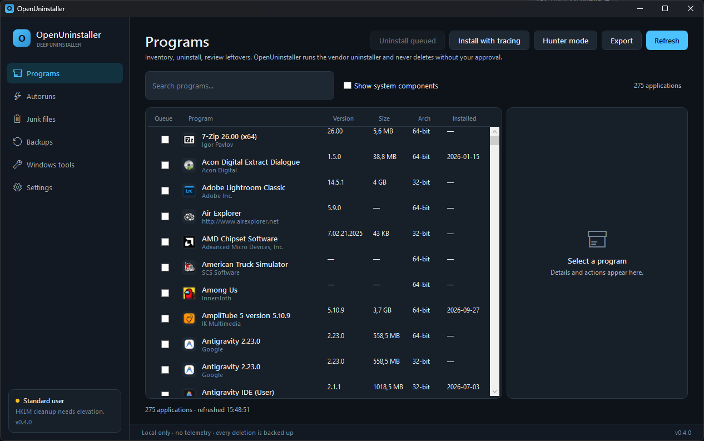
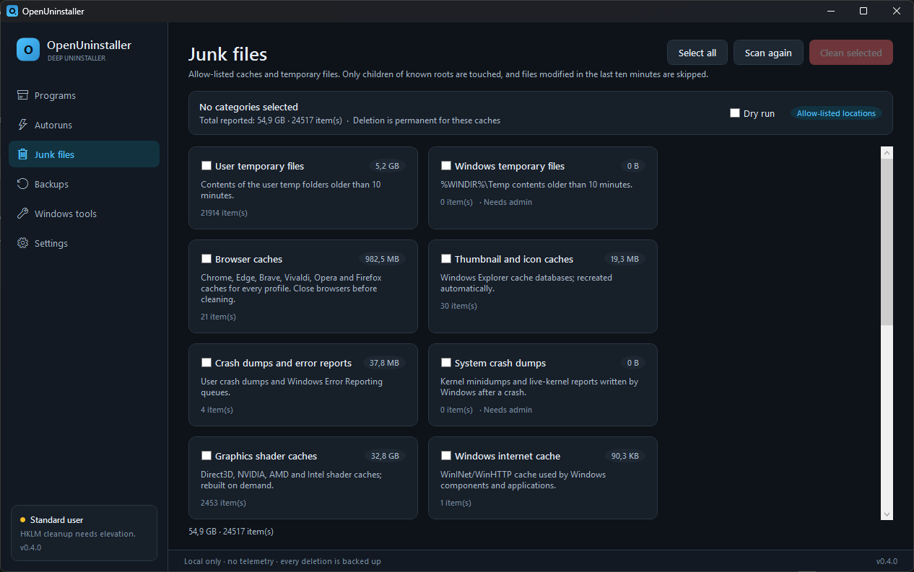
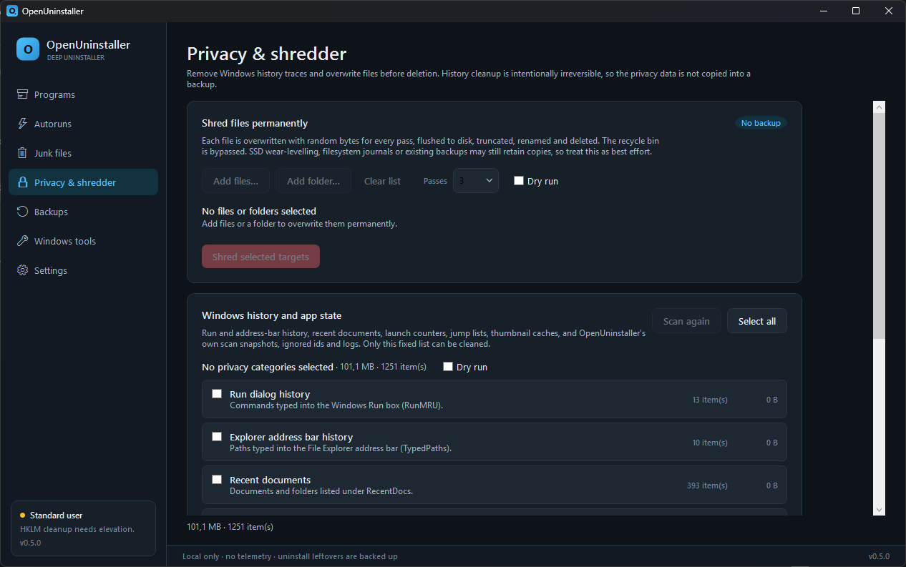
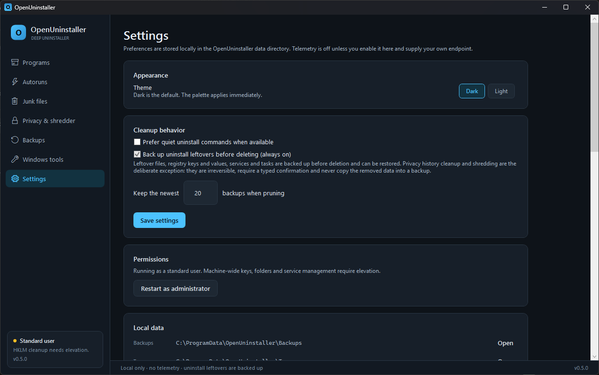

# OpenUninstaller

**A free, MIT-licensed Windows application manager and deep uninstaller.**

OpenUninstaller is an original, from-scratch implementation of the "deep uninstaller" workflow
popularised by commercial tools such as Revo Uninstaller Pro. It inventories installed programs,
runs their own uninstallers, finds what they leave behind, backs those traces up, and removes them
only after you approve each item.

> **Independence notice.** This project is not affiliated with, endorsed by, or derived from
> Revo Technologies or Revo Uninstaller. It contains no Revo code, binaries, icons, databases or
> trademarks. Feature names below describe generic uninstaller capabilities. OpenUninstaller never
> modifies or removes an existing Revo installation; it treats every installed application the same
> way, and destructive actions are always explicit.

## Why

Windows' "Apps & features" page only calls the uninstaller an application registered for itself.
It cannot tell you what the application left in the registry, in `%APPDATA%`, in `ProgramData`, or
in the Start Menu. OpenUninstaller adds:

- the applications' own uninstall command, with silent-mode support;
- a before/after snapshot of the registry and common install locations;
- an optional **traced install** mode that records exactly what an installer creates, so later
  leftover detection is exact instead of heuristic;
- a review screen with per-item selection and confidence levels;
- a verified backup of every key and file before it is removed, plus one-click restore;
- supporting tools: autorun manager, junk cleaner, privacy history cleaner, file shredder, backup
  browser, and a window "hunter" that maps a running window back to the program that owns it;
- an optional maintenance service for backup retention, log expiry, and scan history cleanup;
  100% offline with zero telemetry and zero external network calls.

## Features

| Area | What you get |
| --- | --- |
| Program inventory | 64-bit and 32-bit registry views, per-user installs, search/sort, icons, publisher, size, install date, export to JSON/CSV, and a batch queue that reviews each selected application separately |
| Store apps | Read-only MSIX and Microsoft Store package inventory with publisher, architecture, install location and manifest details |
| Uninstall | Registered uninstall string, quiet uninstall preference, MSI product handling, exit code and output capture, still-registered detection |
| Leftovers | Trace-based exact detection plus a scored heuristic scan of registry keys, individual values, App Paths/Classes registrations, orphaned services, scheduled tasks, resolved `.lnk` shortcut targets and file locations; ignored items stay hidden and scans compare against the previous snapshot |
| Safety | Admin-aware, allow-listed paths, reparse-point protection, per-item selection, dry runs, full backup manifest with SHA-256 hashes |
| Backup & restore | Registry exports, file copies, zip archives, read-only restore preview, restore verification, retention policy |
| Tracing | Snapshot an installer run and keep a reusable trace for later removal; export/import portable bundles with SHA-256 integrity checks |
| Tools | Autoruns (Run/RunOnce, Startup folders, Windows services, scheduled tasks), junk scanner (temp, browser/shader/developer caches, dumps, recycle bin), hunter mode, Windows tools shortcuts |
| Privacy | Run/address-bar history, recent documents, launch counters, jump lists, thumbnail/icon caches and the app's own scan state; typed confirmation and no backup of the removed traces |
| Shredder | Multi-pass random overwrite, flush, truncate, rename and delete for files and folders; dry run, typed confirmation, guard checks and no recycle bin |
| Maintenance | Optional Windows service for backup retention, log/scan-history expiry and an optional allow-listed junk cleanup |
| Automation | `oucli` with JSON output for inventory, msix, uninstall, leftovers, traces, backups, autoruns, junk, privacy, shredding, maintenance, service and doctor |
| Release engineering | Tag-triggered GitHub Actions build/test/package with a SHA-256 sidecar, Inno Setup installer, self-contained zip, UI automation smoke test, issue/PR templates and Dependabot |
| Network | 100% offline. Zero telemetry, zero analytics, zero external network connections |

## Screenshots









## Requirements

- Windows 10 1809+ or Windows 11, x64
- [.NET 8 SDK](https://dotnet.microsoft.com/download/dotnet/8.0) to build
- Administrator rights for machine-wide (`HKLM`) leftovers, some junk locations and installing or
  removing the optional maintenance service; the UI detects this and offers an elevation restart

## Build and run

```powershell
git clone <your-fork-url> openuninstaller
cd openuninstaller
dotnet build OpenUninstaller.sln -c Release
dotnet run --project src/OpenUninstaller.App
```

Run the test suite:

```powershell
dotnet test OpenUninstaller.sln -c Release
```

Publish a self-contained x64 build:

```powershell
pwsh -File scripts/publish.ps1
# output: artifacts/publish/win-x64
```

Create the distributable release zip and checksum:

```powershell
pwsh -File scripts/package-release.ps1 -Configuration Release -Runtime win-x64
# output: artifacts/release/OpenUninstaller-<version>-win-x64.zip (+ .sha256)
```

Pushing a `v*` tag runs [the release workflow](.github/workflows/release.yml), repeats the build and
tests, then attaches the zip and checksum to a GitHub release. The one-time repository setup is
described in [docs/GITHUB.md](docs/GITHUB.md).

## CLI quick start

```powershell
# List detected applications (read-only)
dotnet run --project src/OpenUninstaller.Cli -- list

# Machine-readable inventory
dotnet run --project src/OpenUninstaller.Cli -- list --json

# Scan one application for leftovers without deleting anything
dotnet run --project src/OpenUninstaller.Cli -- scan-leftovers "Example App"

# Compare with the previous scan; ignore preselected items for this app
dotnet run --project src/OpenUninstaller.Cli -- scan-leftovers "Example App" --diff --ignore

# Record an installer run into a reusable trace, then move it to another machine
dotnet run --project src/OpenUninstaller.Cli -- trace-install --installer .\setup.exe --name "Example App"
dotnet run --project src/OpenUninstaller.Cli -- traces export <trace-id> .\example.outrace.zip
dotnet run --project src/OpenUninstaller.Cli -- traces import .\example.outrace.zip

# Full uninstall: run uninstaller, scan, back up and delete approved leftovers
dotnet run --project src/OpenUninstaller.Cli -- uninstall "Example App" --silent --yes

# Supporting tools
dotnet run --project src/OpenUninstaller.Cli -- autoruns list --json
dotnet run --project src/OpenUninstaller.Cli -- autoruns disable <id> --yes
dotnet run --project src/OpenUninstaller.Cli -- autoruns history --json
dotnet run --project src/OpenUninstaller.Cli -- autoruns rollback <id> --yes
dotnet run --project src/OpenUninstaller.Cli -- junk scan
dotnet run --project src/OpenUninstaller.Cli -- backups list
dotnet run --project src/OpenUninstaller.Cli -- backups preview <backup-id> --json
dotnet run --project src/OpenUninstaller.Cli -- doctor

# Privacy: inspect history, then remove selected categories (irreversible, typed gate in the app)
dotnet run --project src/OpenUninstaller.Cli -- privacy scan --json
dotnet run --project src/OpenUninstaller.Cli -- privacy clean run-history recent-items --yes

# Shred a file or folder with three overwrite passes (best effort; needs --yes)
dotnet run --project src/OpenUninstaller.Cli -- shred .\old-secret.bin --passes 3 --dry-run
dotnet run --project src/OpenUninstaller.Cli -- shred .\old-secret.bin --passes 3 --yes

# Maintenance and the optional Windows service (service changes need an elevated shell)
dotnet run --project src/OpenUninstaller.Cli -- msix list --json
dotnet run --project src/OpenUninstaller.Cli -- maintenance run --json
dotnet run --project src/OpenUninstaller.Cli -- service status
dotnet run --project src/OpenUninstaller.Cli -- service install --yes
```

Deletion commands refuse to run without `--yes`. Every uninstall writes a log under
`%ProgramData%\OpenUninstaller\Logs` and a backup under `%ProgramData%\OpenUninstaller\Backups`.

## Documentation

- [Product plan](docs/PLAN/00-product.md)
- [Architecture](docs/PLAN/01-architecture.md)
- [Program inventory and uninstall engine](docs/PLAN/02-inventory-uninstall.md)
- [Leftover engine](docs/PLAN/03-leftover-engine.md)
- [Safety and backups](docs/PLAN/04-safety-backup-restore.md)
- [Tools: autoruns, junk, hunter](docs/PLAN/05-tools.md)
- [UI plan](docs/PLAN/06-ui.md)
- [Testing and release](docs/PLAN/07-testing-release.md)
- [Leftover and junk algorithms](docs/ALGORITHMS.md)
- [Safety model](docs/SAFETY.md) · [User guide](docs/USER-GUIDE.md)
- [Installation and deployment](docs/INSTALLER.md)
- [Capability parity and boundaries](docs/REVO-PARITY.md)
- [GitHub publishing and release checklist](docs/GITHUB.md)
- [Roadmap and progress log](docs/BACKLOG.md) · [Complete task list](TODO.md)
- [Contributing](CONTRIBUTING.md) · [Code of Conduct](CODE_OF_CONDUCT.md) · [Support](SUPPORT.md)
- [Security policy](SECURITY.md) · [Changelog](CHANGELOG.md)

## Project layout

```text
src/OpenUninstaller.Core      domain models, scanners, guards, snapshot, backup, privacy, shredding, maintenance
src/OpenUninstaller.Cli       argument parsing, JSON output, confirmation gates
src/OpenUninstaller.App       WPF shell, pages, view-models, theme
src/OpenUninstaller.Service   optional Windows maintenance service (no third-party hosting package)
tests/OpenUninstaller.Tests   isolated xUnit fixtures for every core service
tests/OpenUninstaller.UiSmoke read-only UI Automation smoke test suite verifying all 8 views
installer/                    Inno Setup 6 installer script and assets
docs/PLAN                    one plan per subsystem
docs/ALGORITHMS.md           precise leftover/junk rules and scoring
scripts/publish.ps1          self-contained win-x64 app + CLI + service
```

## Limitations (v0.5)

- Windows only. No Microsoft Store/MSIX application management yet.
- Install tracing indexes well-known locations with a cap; very large machines may need a second
  pass. Traces are stored per-machine; use a portable `.outrace.zip` bundle to move one.
- Heuristic leftover matches are suggestions, never automatic deletions. Only high-confidence or
  traced items are preselected, and the user must still approve the deletion.
- Registry values are traced only when they are added to a pre-existing key by a schema 2 trace.
  Modified values and values in protected Microsoft trees are not offered. Schema 1 traces keep
  their registry keys protected because the evidence is ambiguous.
- For leftovers, services are offered only when their image is missing; the cleaner does not stop
  or query the Service Control Manager. Scheduled tasks are inferred from their XML command;
  COM-handler tasks and tasks outside the XML store are not covered.
- Autoruns can disable automatic/manual services and scheduled tasks reversibly, but deliberately
  excludes boot and system drivers. A service that was disabled outside OpenUninstaller has no
  stored original start mode, so enabling it cannot restore an unknown previous value.
- Service and task toggles need administrator rights for machine-wide entries; the UI reports the
  access error instead of requesting elevation silently.
- File associations outside `Classes\Applications`, COM registration, drivers, `PATH` entries and
  firewall rules are out of scope.
- Junk cleaning does not back up caches and never touches other users' profiles, restore points or
  `Windows.old`. Windows Update, `Windows.old`, servicing logs and prefetch are report-only.
- A full junk scan on a machine with very large browser or shader caches can take several seconds;
  categories are shown as they finish.
- The batch queue opens each application's own uninstall and review window. It is not an
  unattended mass-uninstall path.
- Ignored leftovers are keyed by application id and display name; reset the ignored list from the
  review window to show them again.
- Scan history keeps one snapshot per application name. The CLI records it only with `--diff`; the
  desktop review always records it.
- Portable traces normalize known Windows roots (`%ProgramFiles%`, `%LOCALAPPDATA%`, and so on).
  Other absolute paths are preserved and still pass every guard before deletion.
- Restore preview is advisory; the actual restore revalidates the manifest, archive hash and guard
  rules.
- Shredding is best effort: SSD wear-levelling, filesystem journals, volume snapshots and existing
  backups can retain copies. It is not a certified sanitisation standard.
- Privacy cleaning covers the fixed list shown in the app; it does not clear browser histories,
  cookies, saved passwords or account data. Those belong to the browser, not to this tool.
- Locked thumbnail/icon cache files held by Explorer are reported and skipped; the app does not
  restart Explorer.
- Zero telemetry: 100% offline, privacy-first, and zero network calls. No telemetry services or
  network endpoints exist in the application.
- The maintenance service is optional and runs as LocalSystem. Its junk cleanup is limited to the
  same allow-list and never touches other users' profiles; service install/remove needs elevation.
- Code signing is not included; publish output is unsigned.

## License

MIT. See [LICENSE](LICENSE). Third-party runtime is .NET 8 (MIT).
