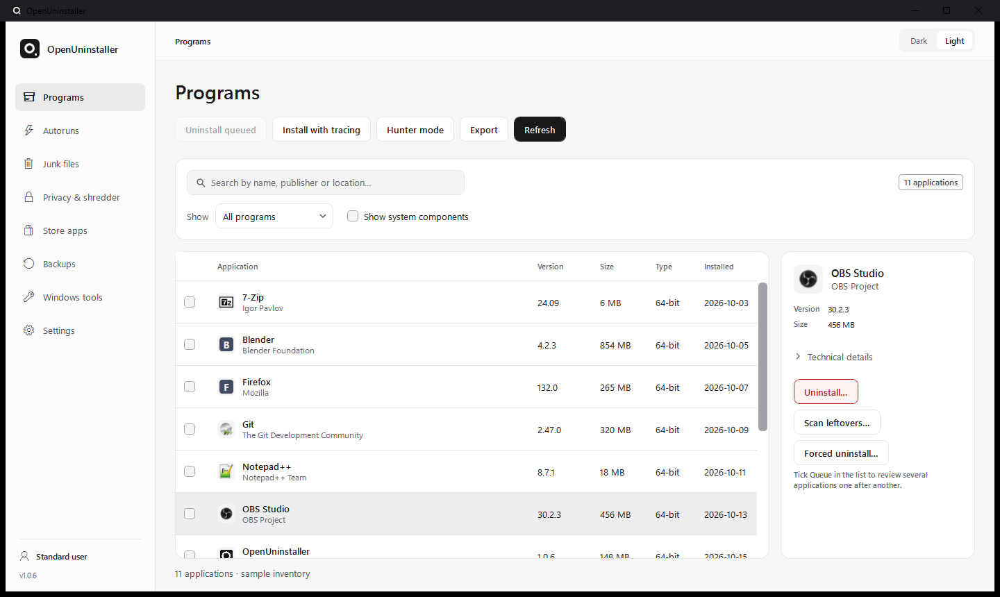
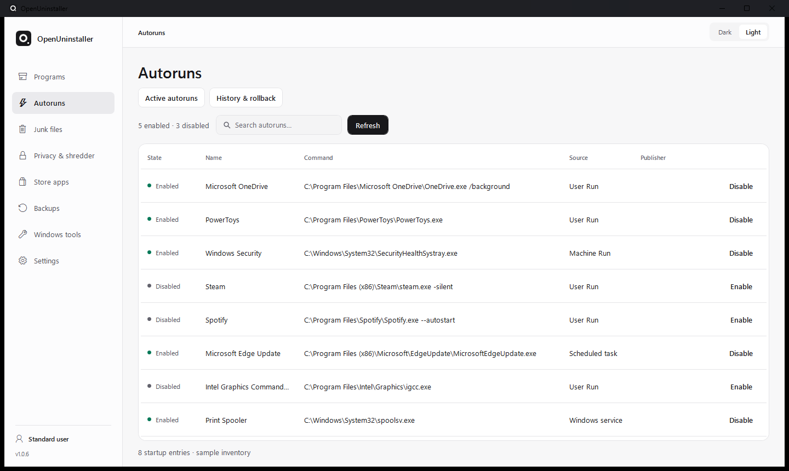
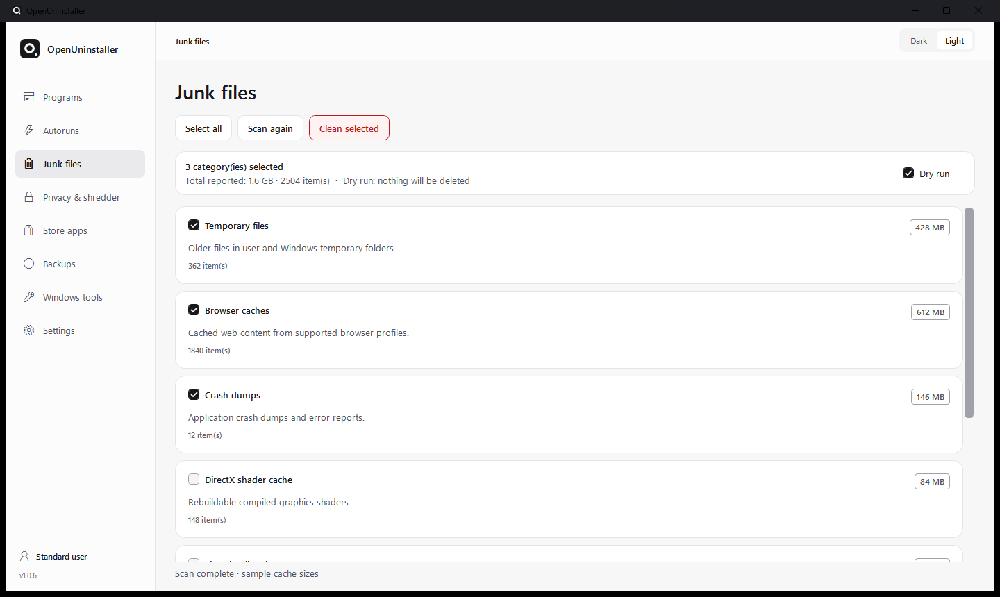
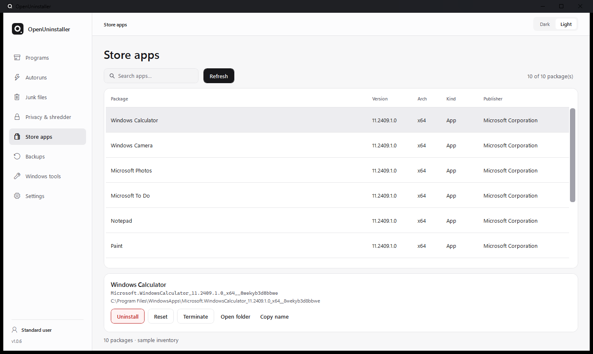
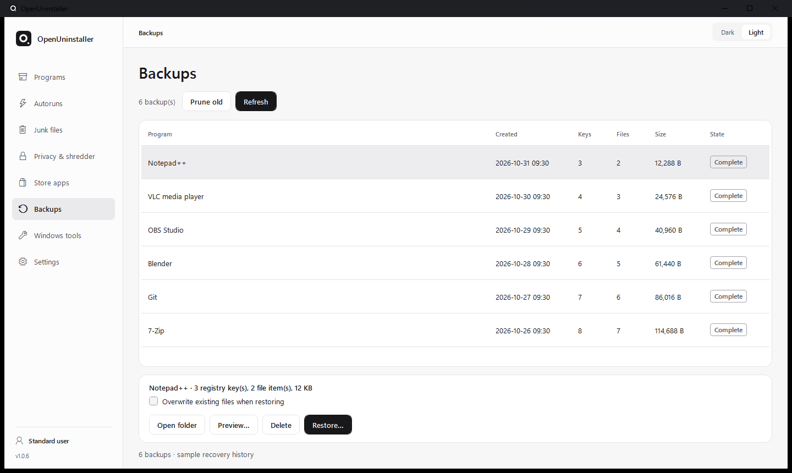
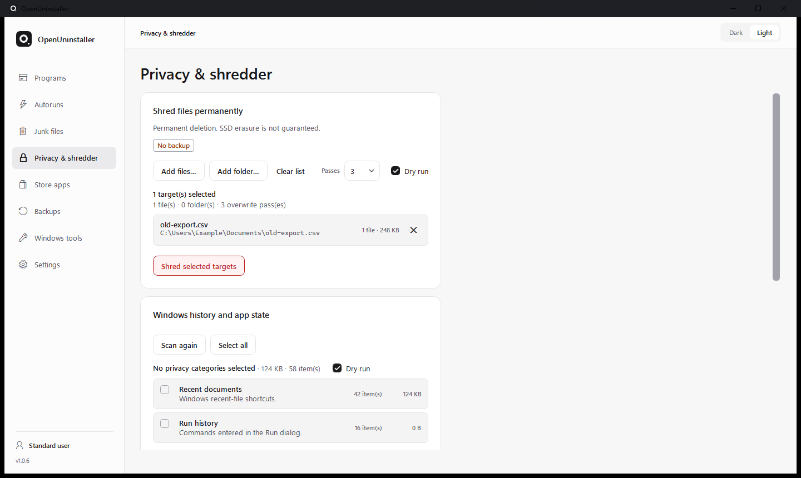
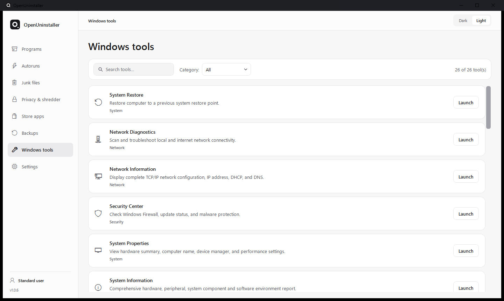
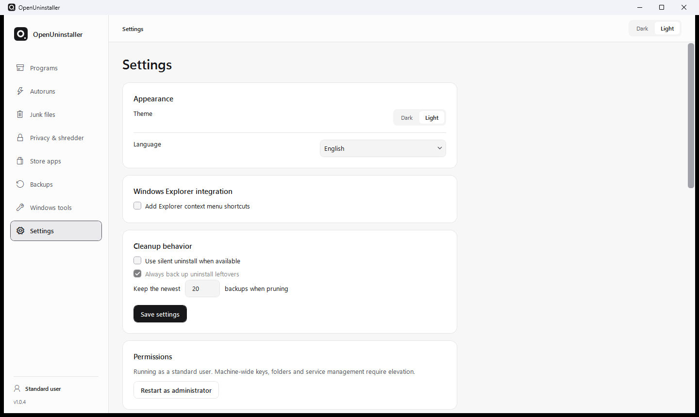
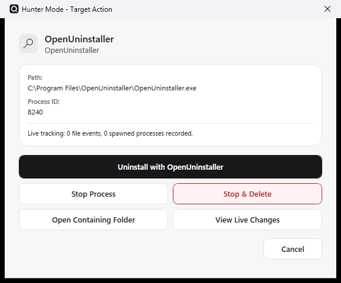

<div align="center">


<h1>OpenUninstaller</h1>

<p>A native Windows application manager with reviewed leftover cleanup.</p>

[](https://github.com/eco-null/OpenUninstaller/actions/workflows/ci.yml)
[](LICENSE)
[](#requirements)
[](#build-from-source)

[Download](https://github.com/eco-null/OpenUninstaller/releases/latest) · [Features](#features) · [Getting started](#getting-started) · [Documentation](#documentation)

</div>

OpenUninstaller helps you inspect installed software, run its registered uninstaller, and review the files and registry entries left behind. It combines installation traces with heuristic scanning, shows the evidence for each candidate, and backs up approved uninstall leftovers before deletion.

The WPF desktop application and command-line interface share the same core services. OpenUninstaller runs locally, includes no telemetry, and has no third-party runtime UI dependencies.

## Desktop interface

Light and dark themes share a restrained layout, searchable inventories and consistent controls. The application inspector can be resized; secondary instructions stay out of the main workflow.

<picture>
  <source media="(prefers-color-scheme: dark)" srcset="docs/assets/programs-dark.png">
  
</picture>

<p align="center"><sub>Screenshots use sample data. Images follow your GitHub light or dark theme.</sub></p>

## Features

| Area | Capabilities |
| --- | --- |
| Applications | Search installed programs, inspect metadata, export inventory and queue multiple uninstalls for individual review. |
| Leftover review | Inspect files, folders, registry keys and values, shortcuts, services and scheduled tasks with confidence and evidence. Ignore candidates or compare scans. |
| Installation tracing | Capture registry and filesystem changes around an installer; import and export portable `.outrace.zip` bundles. |
| Store apps | Inspect Microsoft Store/MSIX packages, open their locations, and uninstall, reset or terminate selected packages. |
| Startup management | Review startup entries, services and scheduled tasks; disable supported entries and restore their recorded state. |
| Junk files | Scan supported cache and temporary-file locations, review categories and preview cleanup with dry run. |
| Privacy tools | Review Windows history and supported browser data; shred selected files or wipe free disk space. |
| Backups | Inspect backup contents, preview a restore and restore captured uninstall leftovers. |
| Windows tools | Launch built-in administrative utilities and add custom shortcuts. |
| Hunter mode | Select a window to identify its process, executable and matching installed application. |
| Maintenance | Configure an optional Windows service for backup retention, log expiry and supported cleanup tasks. |

See the [capability matrix](docs/CAPABILITIES.md) for implementation details and boundaries.

## Screenshots

<table>
  <tr>
    <td width="50%">
      <p><strong>Autoruns</strong> — review startup entries, services and tasks.</p>
      <picture><source media="(prefers-color-scheme: dark)" srcset="docs/assets/autoruns-dark.png"></picture>
    </td>
    <td width="50%">
      <p><strong>Junk files</strong> — inspect cache categories and preview cleanup.</p>
      <picture><source media="(prefers-color-scheme: dark)" srcset="docs/assets/junk-dark.png"></picture>
    </td>
  </tr>
  <tr>
    <td>
      <p><strong>Store apps</strong> — inspect packages and their available actions.</p>
      <picture><source media="(prefers-color-scheme: dark)" srcset="docs/assets/store-dark.png"></picture>
    </td>
    <td>
      <p><strong>Backups</strong> — review recovery history before restoring.</p>
      <picture><source media="(prefers-color-scheme: dark)" srcset="docs/assets/backups-dark.png"></picture>
    </td>
  </tr>
  <tr>
    <td>
      <p><strong>Privacy &amp; shredder</strong> — review history and file-shredding targets.</p>
      <picture><source media="(prefers-color-scheme: dark)" srcset="docs/assets/privacy-dark.png"></picture>
    </td>
    <td>
      <p><strong>Windows tools</strong> — find built-in administrative utilities.</p>
      <picture><source media="(prefers-color-scheme: dark)" srcset="docs/assets/tools-dark.png"></picture>
    </td>
  </tr>
  <tr>
    <td>
      <p><strong>Settings</strong> — choose appearance, language and cleanup preferences.</p>
      <picture><source media="(prefers-color-scheme: dark)" srcset="docs/assets/settings-dark.png"></picture>
    </td>
    <td>
      <p><strong>Hunter mode</strong> — identify a window's process and executable.</p>
      <picture><source media="(prefers-color-scheme: dark)" srcset="docs/assets/hunter-dark.png"></picture>
    </td>
  </tr>
</table>

## Getting started

### Download

Choose an installer or portable archive from [GitHub Releases](https://github.com/eco-null/OpenUninstaller/releases/latest).

- **Installer:** Run `OpenUninstaller-<version>-setup.exe`. It installs for the current user in `%LOCALAPPDATA%\Programs\OpenUninstaller` without an administrator prompt; choose *Install for all users* (or pass `/ALLUSERS`) to install in `Program Files`. The wizard is available in English and Turkish, and an optional task adds `oucli` to PATH.
- **Portable:** Extract the archive and run `OpenUninstaller.exe`. The command-line executable is in `cli\oucli.exe`; the optional service is in `service\`.

Both packages are self-contained and include the .NET runtime. Each download has a `.sha256` checksum next to it. Release builds are not code-signed, so Windows SmartScreen may ask for confirmation. See the [installation guide](docs/INSTALLER.md) for silent installer flags.

### Updating

Download the newer `setup.exe` and run it. Setup recognises the installed version and updates it in place: it keeps the install folder, per-user or all-users mode, language and shortcut choices, closes a running OpenUninstaller, and shows the version change before installing. Settings, backups and traces are not touched. Setup refuses to install an older version over a newer one; uninstall first to downgrade. The installed version is shown at the bottom of the navigation bar (`oucli version` prints it too).

If the optional maintenance service is installed, setup updates it as well after one administrator prompt. For the portable archive, extract the new version over the old folder or into a new one; if you use the service, then choose **Update service** in Settings (as administrator) or run `oucli service update --yes` from an elevated prompt. See [Maintenance service isolation](docs/INSTALLER.md#maintenance-service-isolation).

### Requirements

- Windows 10 version 1809 or later, or Windows 11, on x64.
- Standard user access for user-scoped operations. Machine-wide changes and service management require administrator rights.
- The .NET 8 SDK to build from source; the .NET 8 Desktop Runtime for framework-dependent desktop builds.

### First uninstall

1. Find an application in **Programs** and inspect its details.
2. Choose **Uninstall** to run the registered vendor uninstaller.
3. Review the leftover scan, including each candidate's evidence and confidence.
4. Confirm the selected cleanup. OpenUninstaller captures a backup before deleting approved leftovers.

You can also run a leftover scan without uninstalling. **Forced uninstall** is intended for stale registrations when the normal uninstaller is unavailable; removing a registration does not itself uninstall the application.

## Safety and data handling

Path and registry guards reject protected targets. Uninstall leftover deletion requires a backup, and a failed capture prevents that item from being deleted. Heuristic matches still need review; a confidence score is evidence to consider, not proof that an item is unused.

Privacy cleanup, cache cleanup, shredding and free-space wiping have different recovery properties. Privacy history and shredding deliberately do not keep copies of the data being removed. Review the confirmation and dry-run options for the operation you choose. Overwriting files or free space cannot guarantee erasure on SSDs, journaled filesystems or existing backups.

Application data, traces, backups and logs stay on the local machine. OpenUninstaller includes no automatic network requests or telemetry; vendor uninstallers and Windows utilities you launch retain their own behavior.

Read the [safety model](docs/SAFETY.md) and [user guide](docs/USER-GUIDE.md) before using cleanup or recovery tools.

## Command-line usage

The CLI is `cli\oucli.exe` in the install folder or portable archive. Select **Add the oucli command-line tool to PATH** in setup to call it as `oucli` from any new terminal, or run the CLI project from source:

```powershell
dotnet run --project src/OpenUninstaller.Cli -- help
```

The following examples assume `oucli` is on your PATH. Otherwise, replace `oucli` with the full path to `cli\oucli.exe`.

Common inspection commands:

```powershell
# Inventory and environment
oucli doctor --json
oucli list --json --filter "Visual Studio"

# Review leftover candidates without uninstalling
oucli scan-leftovers "Example Application" --json
oucli scan-leftovers "Example Application" --diff

# Inspect startup entries, Store apps and cleanup categories
oucli autoruns list --json
oucli store list --json
oucli junk scan --json
oucli privacy scan --json

# Inspect saved evidence and recovery options
oucli traces list --json
oucli backups list --json
oucli backups preview <backup-id> --json
```

Commands that require confirmation document their `--yes` option in `oucli help`. The [command-line section of the user guide](docs/USER-GUIDE.md#command-line) covers operations that change system state.

## Build from source

On Windows with the .NET 8 SDK:

```powershell
git clone https://github.com/eco-null/OpenUninstaller.git
cd OpenUninstaller

dotnet restore OpenUninstaller.sln
dotnet build OpenUninstaller.sln -c Release --no-restore
dotnet run --project src/OpenUninstaller.App -c Release --no-build
```

The SDK version and roll-forward policy are defined in [global.json](global.json).

### Tests

```powershell
dotnet test OpenUninstaller.sln -c Release --no-build

dotnet run --project tests/OpenUninstaller.UiSmoke -c Release --no-build -- `
  src/OpenUninstaller.App/bin/Release/net8.0-windows/OpenUninstaller.exe
```

Core tests use isolated temporary directories and registry subtrees. The UI smoke runner visits all eight screens in both themes at standard and compact window sizes, checks search and selection behavior, and verifies that removed decorative labels stay absent. It reads local inventories without invoking uninstall or cleanup actions.

The runner uses a private Windows desktop that is never shown, so the app under test does not take focus or cover your windows while you keep working. It runs at below-normal priority, and stopping the runner also closes the app. Windows adds about two seconds to each UI Automation action on a hidden desktop, so a full run takes several minutes instead of under one. Add `--visible` to watch a faster run (CI does this). Runs that request window screenshots (a second path argument) use the visible desktop, because WPF draws nothing on a hidden one.

### Packaging

```powershell
./scripts/package-release.ps1 -Runtime win-x64
```

This publishes the desktop app, CLI and maintenance service, then creates a portable archive and SHA-256 checksum. `./scripts/build-installer.ps1` builds the setup with [Inno Setup 6.3+](https://jrsoftware.org/isinfo.php).

### Releases

The version lives only in [Directory.Build.props](Directory.Build.props); the app, CLI, archive and installer all read it. To publish a release, open **Actions › Release › Run workflow** on GitHub and choose `patch`, `minor` or `major`. The workflow bumps the version, builds and tests it, packages the archive and installer, then commits the bump, tags `vX.Y.Z` and publishes the GitHub release. See the [release guide](docs/GITHUB.md) for release notes and signing.

## Project structure

| Project | Responsibility |
| --- | --- |
| `OpenUninstaller.Core` | Inventory, scanning, guards, backup/restore, tracing and maintenance services. |
| `OpenUninstaller.App` | Native WPF desktop interface and view models. |
| `OpenUninstaller.Cli` | Command-line access to the shared core. |
| `OpenUninstaller.Service` | Optional Windows background maintenance host. |
| `OpenUninstaller.Tests` | Core and CLI regression tests. |
| `OpenUninstaller.UiSmoke` | Read-only desktop interaction checks. |

Runtime projects use the .NET libraries and Windows APIs. Test-only packages are declared separately in the test project.

## Documentation

- [User guide](docs/USER-GUIDE.md)
- [Capabilities and boundaries](docs/CAPABILITIES.md)
- [Safety model](docs/SAFETY.md)
- [Scanning algorithms](docs/ALGORITHMS.md)
- [Architecture](docs/PLAN/01-architecture.md)
- [Installation](docs/INSTALLER.md)
- [Release workflow](docs/GITHUB.md)
- [Design system](DESIGN.md)
- [Changelog](CHANGELOG.md)

## Contributing and support

Read [CONTRIBUTING.md](CONTRIBUTING.md) and the [contributor guide](CONTRIBUTOR.md) before submitting a change. For bug reports, include the application version, Windows version and steps to reproduce; remove private paths or application data from shared logs.

See [SUPPORT.md](SUPPORT.md) for support channels and [SECURITY.md](SECURITY.md) for vulnerability reporting.

## License

[MIT](LICENSE).
